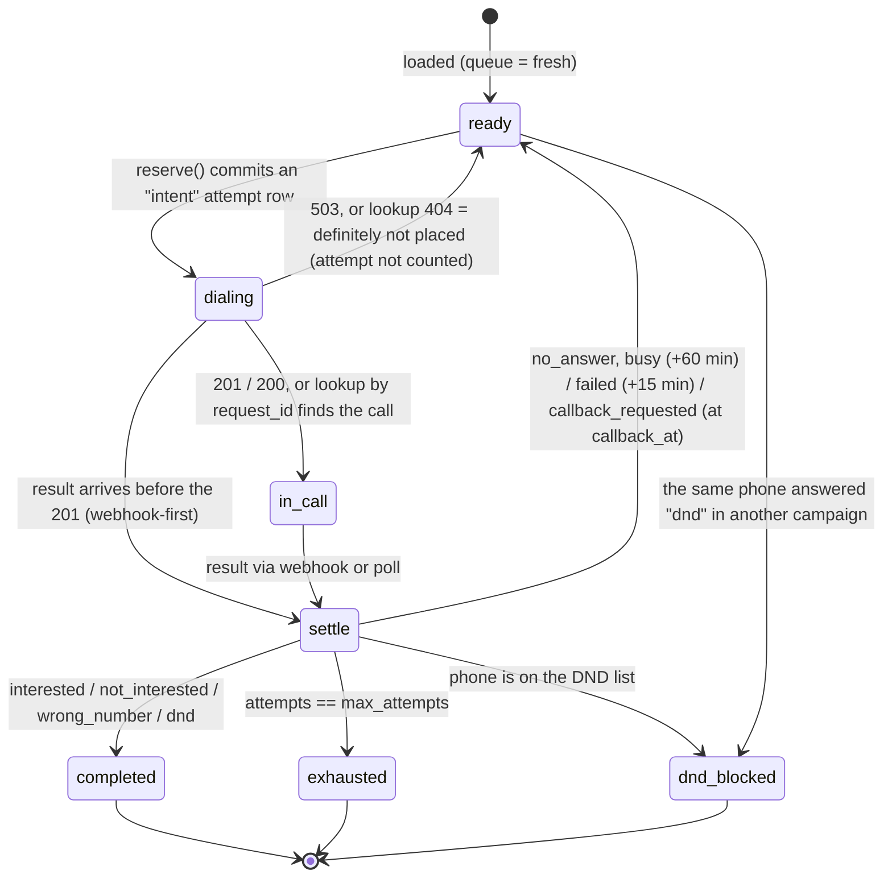

# Submission

## Candidate
- **Name:** Dipak Rajendra Chaudhari
- **Assignment chosen:** B (Workflow): Durable Campaign Dispatcher
- **Time spent (honest estimate):** ~3.5h wall clock, paired with an AI coding agent (see `AI_USAGE.md`), plus ~1h of chaos runs

## How to run
```bash
python -m venv .venv && source .venv/bin/activate        # Windows: .venv\Scripts\activate
pip install -r requirements.txt

# terminal 1: the provider (unchanged)
cd assignment-b-workflow && python -m mock_telephony

# terminal 2: the dispatcher, from the repo root. Runs until every lead is final,
# then writes ./final_state.csv. Safe to kill -9 and re-run at any point.
python -m solution run
python -m solution verify        # diff final_state.csv vs /admin/leads + print /admin/report

# tests (fake clock and fake provider, no waiting on the mock): ~8 s
pytest

# end-to-end: start the mock, kill -9 the dispatcher N times at random moments, verify
python solution/scripts/chaos_run.py --seed 11 --kills 4
python solution/scripts/chaos_run.py --seed 3 --kills 3 --workers 2    # two dispatchers, one DB
```
Tested on Python 3.12 and 3.11. The harness starts the unmodified mock through
`solution/scripts/mock_launcher.py`, which is a plain `python -m mock_telephony` on Linux/macOS
(see the Windows note under failure modes).
State lives in `.state/dispatcher.db` (git-ignored). One database belongs to one provider run;
if you restart the mock, delete `.state/` (the dispatcher refuses to mix the two, see below).
Useful flags: `run --port 8200 --window-guard 60 --latency-budget 0.5 --callback-lookahead 360
--poll-after 180`; global `--db --out --provider --fixtures`. While it runs, `GET :8200/status`
shows per-campaign progress, and stderr carries JSON-lines logs.

## Design

**One process, one SQLite database (WAL), three asyncio loops.** The database is the only source
of truth; memory holds nothing that a crash could lose.

- **dispatch loop** (every 20 ms, or right away when a result frees a slot): for each tenant,
  it claims the best eligible lead in a single `BEGIN IMMEDIATE` transaction, then fires an HTTP
  task.
- **reconcile loop** (every 250 ms): settles attempts whose outcome is unknown, and polls calls
  whose webhook is overdue.
- **webhook receiver** (FastAPI/uvicorn on :8200): verifies the HMAC over the raw body, applies
  the result in one transaction, *then* replies 2xx.

### Data model (`solution/store.py`)
| table | role |
|---|---|
| `leads` | one row per (campaign, lead): `state`, `queue` (fresh/retry/callback), `eligible_at` (earliest the rules allow, sim time), `attempts` (accepted calls), `tries`, `last_*` |
| `attempts` | one row per **decision to dial**, keyed by the `request_id` we send. `state`: intent → accepted → ended, or intent → not_placed |
| `dnd_phones` | global DND list (R8) |
| `journal` | append-only audit trail (triggers forbid UPDATE/DELETE) |
| `workers` | heartbeats, so a process can tell a dead worker's in-flight requests from a live one's |

### Lead lifecycle

`settle` checks completed, then exhausted, then dnd_blocked, which is the precedence R9 requires.

### How at-most-once dialling is guaranteed
1. **Intent before request.** `reserve()` writes the `attempts` row (state `intent`, with its
   `request_id`) and flips the lead to `dialing` in one transaction, *before* the POST leaves. A
   crash at any line therefore leaves at most some `intent` rows, never a call we don't know about.
2. **Ask, never blindly re-send.** An unknown outcome (504, timeout, crash before the response
   was recorded) is settled with `GET /v1/calls?request_id=`: found → accepted (and counted);
   404 → not placed → the lead goes back to `ready`. I deliberately do *not* re-POST the same
   `request_id` after a crash. If the original never landed, a re-POST is a brand-new dial
   decision made later: possibly after the window closed or after another lead with the same
   phone started. That would be a violation the idempotency key cannot prevent.
3. **Slot held while unknown.** An `intent` still occupies its tenant slot and its phone lock
   until it is resolved. We would rather wait a moment than risk exceeding R2 or R3.
4. **Monotonic, idempotent transitions.** Attempt states only move forward. A result for an
   attempt already `ended` is a no-op (duplicate webhooks, webhook plus poll), and a 201 that
   arrives after the webhook only records the `call_sid`.
5. **Ownership.** A worker resolves only its own orphaned intents, or intents whose owner's
   heartbeat is more than 2 s stale, so a live worker's in-flight request is never mistaken for a
   dead one's.

### Every rule is enforced twice
The selection query never picks an ineligible lead, and the schema refuses one if a bug ever did:
- **R3**: partial `UNIQUE` index on `attempts(phone) WHERE state IN ('intent','accepted')`.
- **R2**: a `BEFORE INSERT` trigger counts the tenant's live attempts.
- **R4 / R7 / R8**: the same trigger refuses a lead that isn't `ready`, has no attempts left, or
  whose phone is on the DND list.
- **R1** (time-based) is checked in Python against the provider's clock, with a guard, **twice**: when
  the lead is claimed, and again immediately before the POST leaves (see below).

### Why "our view ≥ the provider's view" makes R2/R3/R8 safe
The provider frees a slot when a call ends; we free it only when we *learn* the call ended. So our
count of active calls is never lower than the provider's, which means we can never exceed the limit.
The same lag protects DND: the phone that said "dnd" stays locked by R3 until we have processed
that result, so no other campaign can dial it in between.

### Scheduling (R1, R5, R6)
- `windows.py` holds pure calendar maths. A campaign's policy is its window intersected with the
  regulatory 09:00–21:00, half-open, on IST dates, with day names. `can_start(t, guard)` and
  `next_start(t)` are what the tests exercise.
- **Ordering inside a tenant:** due callbacks, then due retries, then fresh leads. Within a class
  the longest-waiting goes first. Fresh leads are interleaved across a tenant's campaigns by CSV
  row order, so one campaign can't starve the other.
- **Callback lateness:** a tenant keeps a slot free if one of its callbacks falls due within the
  next 6 sim minutes (`--callback-lookahead`). A fresh call from *another* tenant won't take a
  phone whose callback is about to fall due. Otherwise a 6-minute fresh call would make that
  callback late.

## Decisions & assumptions

| Decision | Why | Alternative considered |
|---|---|---|
| SQLite state machine, not Temporal | 200 leads, one box: one file, inspectable with `sqlite3`, and every transition is a transaction I can point to. The design question (what survives a crash between "decide" and "dial") is the same either way | Temporal: durable timers and retries for free, but a server to run, and the exactly-once dial still needs the same request_id lookup in an activity |
| Resolve unknowns by lookup, not by re-POSTing | Re-sending later can start a call outside the window, or against a phone that is busy by then (see above) | Re-POST the same `request_id`: safe only if the provider re-validated nothing, and it does |
| Deterministic `request_id` = `<db-namespace>-<campaign>-<lead>-<try>` | Readable in logs; the namespace (random per database) prevents collisions if the DB is recreated while the mock keeps running | Random UUIDs: same safety, worse debugging |
| **Adaptive** window guard = max(60 sim s, 0.5 real s × speed, 1.25 × worst decide→accept lag of the last 50 calls), checked at claim **and** at send | The provider checks the window when the request *arrives*. Measured send→accept lag: p50 2.5 sim s on an idle machine, but up to 366 sim s (0.6 real s) when the mock's event loop stalls, and 925 sim s when I ran two chaos runs at once. A fixed guard is tuned for one machine's load, so the guard learns the lag it observes. The lag history is read back from the database, so a kill -9 doesn't reset it to the optimistic default. Cost: fewer new calls in the last minutes of a window when the provider is slow. An early version checked only at claim time, and measuring showed requests landing up to ~2000 sim s (3.3 real s) after the decision when the event loop was busy. Re-checking at send bounds the gap to network transit | A fixed guard (or 0 plus the provider's 120 s grace): works on an idle laptop, fails under load |
| SQLite WAL with `synchronous=NORMAL` | A committed transaction survives `kill -9` (the WAL write has reached the OS). `FULL` only adds power-loss protection, at the cost of an fsync per transition that stalled the event loop | `FULL`: measurably slower dispatch for no gain against the failure the brief tests |
| Poll a call after 180 sim s without a result, then every 0.25 real s | Measured: the mock's webhooks reach us 0.3–2.5 *real* seconds after a call ends (it builds a new HTTP client per delivery), which is 3–25 sim minutes at 600×. Waiting for them would hold tenant slots idle. Polling is read-only and idempotent, so racing the webhook is harmless | Poll only after the provider's redelivery window: much slower recovery, fewer calls per hour |
| Reply 2xx only after the commit | If we die mid-handler the provider redelivers, and polling is the backstop | Ack first, process async: loses results on crash |
| Treat 409/422/429 as "not placed", back off 30 sim min, log loudly | They mean a bug on our side. Backing off avoids repeating the same violation in a loop | Crash the process: a restart would just repeat it |
| A database is bound to one provider run (clock epoch stored in `meta`) | The mock keeps its state in memory; resuming against a restarted mock would trust call records it no longer has | Silently continuing: wrong attempt counts and dial-after-terminal violations |
| `callback_requested` on the last allowed attempt means `exhausted` | R9's definition, and the provider's `/admin/leads` agrees | Keep it alive to honour the callback: would break R4 |
| Unexpected result shapes (`completed` with no disposition, unknown status) are retried after 60 min and journaled as anomalies | Never lose a lead; flag it for a human | Mark it failed: hides data problems |

## Failure modes considered
- **503**: not placed, so the attempt is not counted. The lead is retried 30 sim s later.
- **504, timeout, dropped connection**: outcome unknown. Look up by `request_id` (after 0.5 s
  for transport errors, to let the request land). Found means accepted; 404 means not placed.
  While the provider is unreachable the intent keeps its slot and the reconcile loop keeps asking.
- **Webhook before the 201**: the result settles an attempt still in `intent`; it is counted
  once, and the late 201 only fills in the `call_sid`.
- **Duplicate webhooks, or webhook plus poll**: the second one is a no-op (`result_duplicate` in
  the journal).
- **Lost webhooks**: polling.
- **Forged or corrupted webhooks**: HMAC over the exact raw bytes with `compare_digest`; anything
  else gets a 401.
- **kill -9 at any point**: every transition is atomic. On restart, intents left by the dead
  worker are resolved by lookup, accepted calls are polled, and missed webhooks are recovered.
  Two regression tests simulate a crash before and after the POST.
- **Crash while writing the output**: `final_state.csv` is written to a temp file and renamed.
- **Restarted mock, or different fixtures**: refused with a clear error instead of corrupting state.
- **Two dispatcher processes on one DB**: claims are serialised by `BEGIN IMMEDIATE` and the
  constraints above. Each process needs its own `--port`; any process can apply any result.
- **Event loop stalled between claim and send**: R1 is re-checked at send; if the window has
  closed, the claim is released without sending (`window_closed_before_send`).
- **Windows only, found during chaos runs**: asyncio's Proactor loop stops accepting connections
  after a client is hard-killed mid-connect (`OSError: [WinError 64]`). That took down the
  *mock* once. The dispatcher uses the selector loop on Windows, and the harness starts the
  unmodified mock the same way via `mock_launcher.py`. Linux/macOS are unaffected.

**Not handled / known limits**
- **A callback due in the last few minutes before its window closes** (5 at 600×) is pushed to the next
  window opening, because the guard won't start a call that late. Example: zen callback at Fri
  17:59, zen closes 18:00, next opening Mon 09:30. That single callback shows up as ~3800 min of
  "lateness". This is deliberate: a call outside the window is a compliance breach, and a late
  callback is not.
- Clock skew between hosts. The clock is computed locally from the provider's epoch, which is
  exact on one machine. Across machines I'd resync from `/v1/clock` periodically and widen the guard.
- A provider that *loses* an accepted call (lookup 404 for a call it accepted) would make us
  release the slot. The mock never does this. A real carrier would need a reconciliation feed.
- No backpressure if the provider returns 503 for a long time: each lead backs off 30 sim s, but
  there's no global circuit breaker.

## Testing
`pytest` runs 52 tests in ~7 s, with no network and no waiting:
- **window maths**: half-open bounds, day names, the regulatory intersection, IST vs UTC, the
  guard, `next_start` across nights and weekends.
- **state machine**: tenant limit shared across campaigns, phone lock across tenants, 503 not
  counted, retry delays 60/15, callbacks at `callback_at`, priority callback > retry > fresh,
  exhausted after 3, callback on the last attempt, DND cascade across campaigns, precedence
  exhausted > dnd_blocked, duplicate webhook, webhook before 201, append-only journal, binding
  to fixtures and provider run.
- **database constraints**: the R2/R3 triggers and index reject direct inserts that would break the rules.
- **dispatcher vs a scripted fake provider**: 503, 504 placed, 504 not placed, provider down
  (slot held), lost webhook recovered by poll, crash before / after POST, a live worker's
  intents left alone, a regression for the claim/reconcile race, slot and phone held for an
  imminent callback, a callback outside the window dialled at the next opening, retry exactly at
  +60 min, the window re-checked at send time, the guard widening with observed latency and
  surviving a restart.
- **webhook endpoint**: bad signature → 401 and state unchanged; valid → applied; replay → duplicate.

End to end: `solution/scripts/chaos_run.py` runs the real mock and hard-kills the dispatcher
(SIGKILL; TerminateProcess on Windows).

Not tested: multi-host clock skew, and long provider outages beyond a few seconds.

## Results
All runs: the unmodified mock on Windows 11 / Python 3.12, failure injection on unless noted.
"Kills" are SIGKILL-equivalent (`TerminateProcess`) of the dispatcher at random moments,
restarted on the same database. Every run ended with all 200 leads final.

**Final code**, `python solution/scripts/chaos_run.py --seed 2026 --kills 8`:
```
violation_count: 0          max_concurrency_seen: acme_insurance 4/4, zen_retail 3/3
calls_total: 425            calls_by_status: completed 220, no_answer 117, busy 58, failed 30
final_state.csv vs /admin/leads: 200 rows, 0 differences
callback_lateness_minutes: p50 2.7, p90 22.8, max 42.1  (72 callbacks)
webhooks: delivered 450, lost 19, duplicates 44, connect_errors 24 (sent while we were dead)
kills: 8, at sim Thu 21:10, Fri 07:47, Fri 17:32, Sat 02:56, 07:38, 11:11, 17:49, Sun 02:33
lag (sim s): decide→send p50 0.6 / max 5.7; send→accept p50 2.4 / max 336; guard settled at 419 s
wall time: 578 s at 600x (Thu 17:30 → Mon ~17:20 sim; zen only dials Mon-Fri)
```

**Every end-to-end run** (earlier rows used earlier revisions of the code; each change is in the
git history with the measurement that motivated it):

| seed | speed | kills | workers | violations | diffs vs provider | callback lateness p50 / p90 / max (min) | note |
|---|---|---|---|---|---|---|---|
| 7 | 600× | 0 | 1 | 0 | 0 | 3.0 / 7.9 / 18.0 | failure injection **off** |
| 11 | 600× | 4 | 1 | 0 | 0 | 4.4 / 17.2 / 26.6 | |
| 3 | 1200× | 3 | 2 | 0 | 0 | 8.0 / 31.8 / 947 | two dispatchers, one DB |
| 21 | 600× | 5 | 1 | 0 | 0 | 2.4 / 11.1 / 3811 | max = the Fri 17:59 zen callback (see limits) |
| 42 | 600× | 12 | 1 | 0 | 0 | 2.6 / 49.9 / 99.7 | kills spread across business hours |
| 3 | 1200× | 3 | 2 | 0 | 0 | 11.9 / 51.2 / 2365 | ran concurrently with another chaos run |
| 42 | 600× | 8 | 1 | 0 | 0 | 1.9 / 18.5 / 50.4 | after the send-time window re-check |
| 99 | 600× | 8 | 1 | 0 | 0 | 4.7 / 29.2 / 3818 | concurrent run; max = a Fri ~17:59 zen callback |
| 5 | 600× | 4 | 2 | 0 | 0 | 2.4 / 27.4 / 903 | concurrent run; two dispatchers |
| **2026** | 600× | 8 | 1 | **0** | **0** | **2.7 / 22.8 / 42.1** | **final code** |

One run (not in the table) failed for an environmental reason: on Windows the *mock's* accept loop
died with `WinError 64` after a client was killed mid-connect, and the mock stopped accepting
connections. That led to `mock_launcher.py` and the selector loop (see failure modes).

Surprising things in the data:
- **Webhooks are the slow path here.** The mock builds a new HTTP client per delivery, so results
  arrive 0.3–2.5 real seconds after a call ends. In the final run, 51 of the results applied in the
  last dispatcher process came from polling; the webhooks for those calls then arrived as harmless
  duplicates.
- **Callback lateness is dominated by window edges**, not by capacity: a callback due a few minutes
  before close waits for the next opening (possibly after a weekend), which the provider counts in
  full. Away from window edges, p50 stays around 2–5 minutes.

## If I had another day
1. **Event-driven scheduling**: sleep until the next `eligible_at` or window opening instead of
   ticking every 20 ms (fine at 200 leads, wasteful at 1M).
2. **Postgres + `SELECT … FOR UPDATE SKIP LOCKED`** for real horizontal scale. Per-tenant slot
   counters in a row, not `COUNT(*)`.
3. **Temporal port** of the same state machine, to compare the code honestly.
4. **Metrics**: dial latency, result latency by source (webhook vs poll), callback lateness as
   histograms.
5. **Note for 1M leads/day across 50 tenants**: partition by tenant (concurrency is per tenant,
   so tenants are independent apart from shared phones). Hold the cross-tenant phone lock in a
   small shared store (a unique-key table, or Redis `SET NX` with a TTL backed by the DB).
   Precompute each lead's next eligible time into an indexed queue, so selection is O(log n).
   Treat webhooks as hints and let the poller/reconciler be the guarantee.
